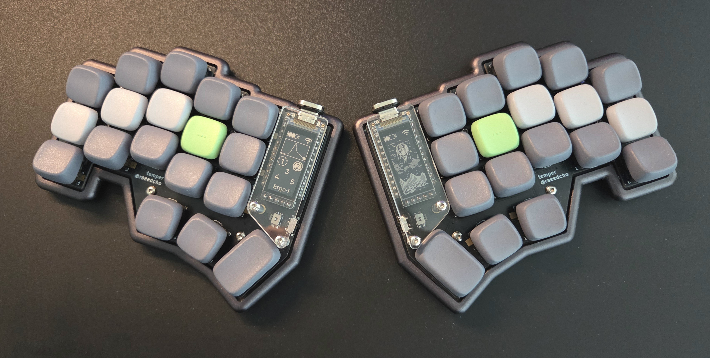
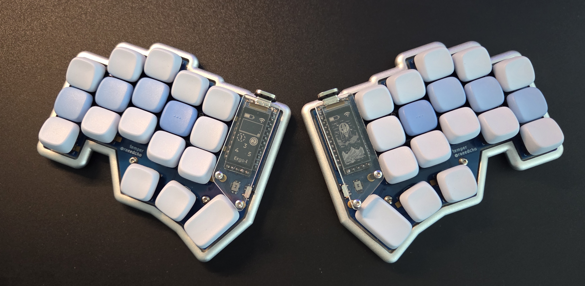
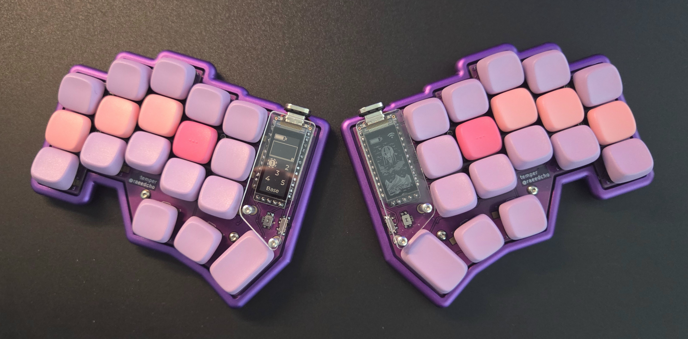
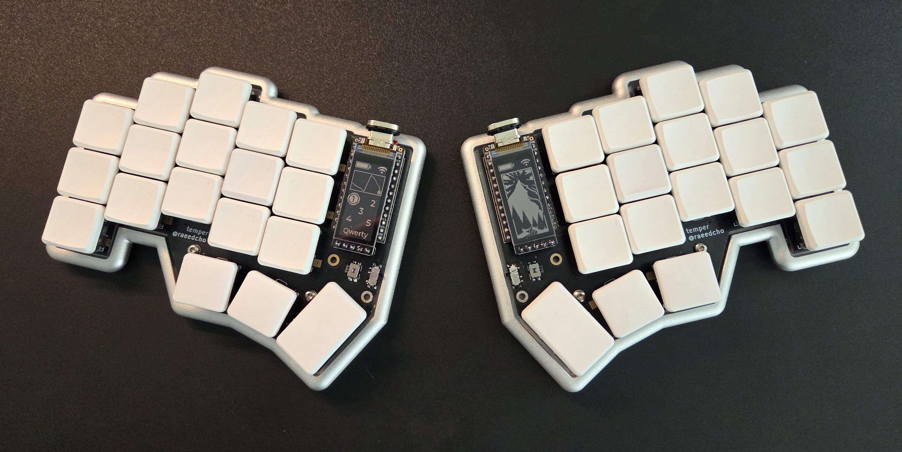
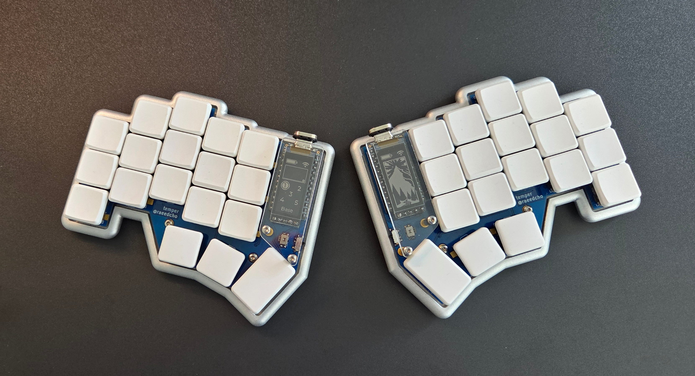
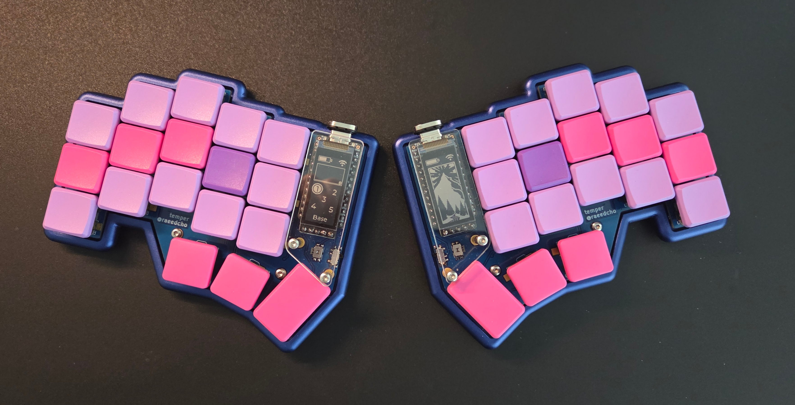

Ækeynox-ZMK with Ergo-l emulation for azerty Windows for Temper Keyboard
====================================================================================================
This is my personnal [Ækeynox](https://github.com/OneDeadKey/zmk-config-aekeynox) branch for the [Temper](https://github.com/raeedcho/temper) Keyboard.
It keeps the standard Ækeynox implementation on the base layer, but add an as complete as possible [Ergo-l](https://ergol.org/) emulation for Azerty Windows computer, in HRM non VI mode, wich can be toggle on or off without need to reflash the keyboard, by pressing Function+Shift+c (the 'c' key in ergol layout) and Function+Shift+q. (the 'q' key in ergol layout).
This can be mandatory on azerty windows computers on wich you don’t have the permissions to install the Ergo-L layout driver (typically in a professional environment)

The Ergol-l emulated layout is not totally implemented, but there are as much complete layers I succeeded to emul:
base, 1dk, navnum, numlock, sym, caplock and their shifted version.

I have added a custom function layer and a custom BT layer, so function layer is not totally identical to default selenium implementation.

Some pictures of the tempers I built, with [anodized aluminum case](https://github.com/CoenTurk/temper-metal) from [CoenTurk](https://github.com/CoenTurk):

